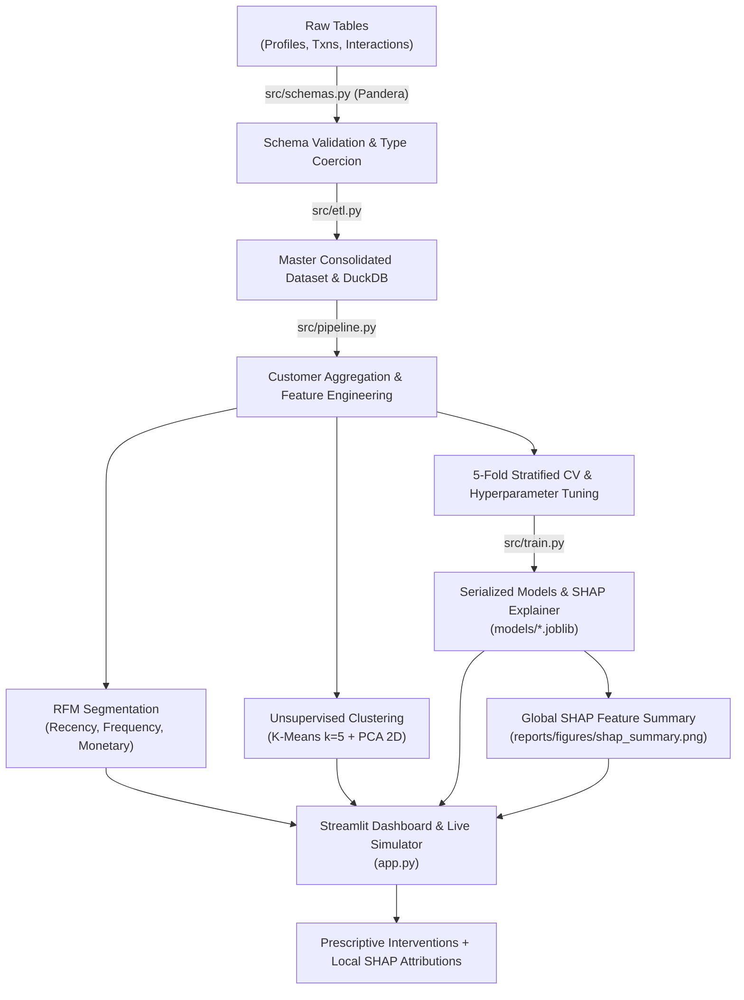

# 💳 Fintech Customer Analytics & Explainable Churn Prediction

A comprehensive end-to-end data science and machine learning platform for analyzing digital banking customer behavior, transaction patterns, customer satisfaction (NPS), RFM segmentation, and proactive churn risk prediction with **Pandera data validation contracts, Stratified 5-Fold Cross-Validation, SHAP model explainability, Docker containerization, and GitHub Actions CI/CD**.

---

## 📋 Table of Contents
- [Project Overview](#project-overview)
- [Enterprise Architecture & Quality Upgrades](#enterprise-architecture--quality-upgrades)
- [Project Structure](#project-structure)
- [Analytical & Machine Learning Workflow](#analytical--machine-learning-workflow)
  - [1. Data Extraction & Pandera Validation ETL](#1-data-extraction--pandera-validation-etl)
  - [2. Feature Engineering & Preprocessing](#2-feature-engineering--preprocessing)
  - [3. RFM Customer Segmentation](#3-rfm-customer-segmentation)
  - [4. K-Means Clustering & PCA](#4-k-means-clustering--pca)
  - [5. Supervised Churn Prediction & Imbalance Metrics](#5-supervised-churn-prediction--imbalance-metrics)
  - [6. SHAP Explainability Engine (Global & Local)](#6-shap-explainability-engine-global--local)
  - [7. Strategic Retention Priority Matrix](#7-strategic-retention-priority-matrix)
- [Quickstart Guide](#quickstart-guide)
- [Docker & Containerized Deployment](#docker--containerized-deployment)
- [Dashboard Walkthrough & Real-Time Simulator](#dashboard-walkthrough--real-time-simulator)
- [Automated Testing & Quality Assurance](#automated-testing--quality-assurance)

---

## 🚀 Project Overview

In fintech and digital banking, customer retention is directly tied to customer lifetime value (LTV). Identifying disengagement before churn occurs enables proactive retention interventions.

This platform provides:
- **Data Contracts & Integrity**: Strict Pandera schemas validating incoming raw tables and feature stores.
- **Centralized Structured Logging**: Rotating console and persistent file logs (`logs/fintech_platform.log`).
- **Customer Segmentation**: Unsupervised K-Means clustering and RFM (Recency, Frequency, Monetary) behavioral scoring.
- **Sentiment & Experience Analytics**: Net Promoter Score (NPS) analysis coupled with customer service ticket volumes and channel preferences.
- **Predictive Churn Modeling**: 5-Fold Stratified Cross-Validation with hyperparameter tuning on Random Forest, Gradient Boosting, and Logistic Regression.
- **Explainable AI (XAI)**: SHAP TreeExplainer delivering global summary beeswarm plots and local customer-level waterfall attributions in the live simulator.
- **Real-Time Churn Simulator**: Interactive what-if evaluation for single customer profiles with prescriptive retention recommendations.
- **Production DevOps**: Multi-stage Docker containerization, `docker-compose`, `pyproject.toml`, and GitHub Actions CI/CD.

---

## 📂 Project Structure

```
Fintech Data Analysis/
├── .github/
│   └── workflows/
│       └── ci.yml                     # Automated GitHub Actions CI workflow
├── data/
│   ├── raw/                           # Original, immutable datasets
│   │   ├── customer_profiles.csv      # Demographics, account types, open dates
│   │   ├── digital_interactions.csv   # App/portal logins, service tickets, NPS
│   │   └── transaction_ledger.csv     # UPI, ATM, NEFT transactions & amounts
│   ├── processed/                     # Cleaned, merged, and aggregated datasets
│   │   ├── cleaned_digital_interactions.csv
│   │   ├── customer_level_dataset.csv
│   │   ├── master_dataset.csv         # Consolidated table for analysis & modeling
│   │   └── master_dataset_cleaned.csv
│   └── database/                      # Embedded database storage
│       ├── master_dataset.db          # DuckDB database table
│       └── master_dataset.db.wal
├── models/                            # Serialized model artifacts (joblib)
│   ├── churn_random_forest.joblib
│   ├── churn_gradient_boosting.joblib
│   ├── churn_logistic_regression.joblib
│   ├── shap_tree_explainer.joblib     # Serialized SHAP explainer
│   ├── scaler_ml.joblib
│   ├── label_encoders.joblib
│   ├── kmeans_cluster.joblib
│   └── pipeline_metrics.json          # Benchmark metrics & best CV hyperparameters
├── notebooks/                         # Sequenced analysis notebooks
│   ├── 01_Fintech_Data_Generation.ipynb
│   ├── 02_Data_Preprocessing.ipynb
│   ├── 03_Exploratory_Data_Analysis.ipynb
│   └── 04_Retention_Analysis.ipynb
├── reports/                           # Output visualizations and reports
│   ├── figures/                       # Generated charts and presentation figures
│   │   ├── Bivariate.png
│   │   ├── Platform and channel.png
│   │   ├── segmentation and clustering.png
│   │   ├── shap_summary.png           # Global SHAP beeswarm feature importance
│   │   ├── Target variable Analysis.png
│   │   └── Univariate.png
│   └── html/                          # Exported interactive notebook reports
│       ├── Exploratory_Data_Analysis.html
│       └── Retention_Analysis.html
├── src/                               # Modular Python package
│   ├── __init__.py
│   ├── config.py                      # Centralized paths, thresholds, and hyperparameters
│   ├── logger.py                      # Centralized structured file and console logger
│   ├── schemas.py                     # Pandera data validation contracts
│   ├── etl.py                         # Validated raw extraction, transformation & DuckDB load
│   ├── pipeline.py                    # Feature engineering, clustering, ML inference & SHAP
│   └── train.py                       # 5-fold CV hyperparameter tuning & SHAP serialization
├── tests/                             # Unit tests & quality verification
│   └── test_pipeline.py               # Comprehensive pytest suite (10 test suites)
├── app.py                             # Interactive Streamlit dashboard entrypoint
├── Dockerfile                         # Production container image definition
├── docker-compose.yml                 # Single-command container deployment
├── pyproject.toml                     # Modern Python packaging & tool configuration
├── pytest.ini                         # Pytest configuration
├── requirements.txt                   # Complete Python dependencies
├── .gitignore                         # Git exclusion rules
└── README.md                          # Project documentation
```

---

## 🔬 Analytical & Machine Learning Workflow



### 1. Data Extraction & Pandera Validation ETL
- Raw tables undergo schema validation via `src/schemas.py` using **Pandera**, ensuring strictly bounded age, non-negative transaction amounts, valid categorical sets, and valid NPS ratings.
- Aggregated transactions and interactions are persisted in `data/processed/master_dataset.csv` and embedded DuckDB `data/database/master_dataset.db`.

### 2. Feature Engineering & Preprocessing
- **Dynamic Recency & Tenure**: Measured against the maximum interaction timestamp with non-negative bounds.
- **Activity Velocities**: `txn_frequency` (annualized transactions), `interaction_frequency`, and `ticket_rate`.
- **Target Definitions**:
  - `churn_risk`: Active (`recency <= 60d`), At Risk (`60d < recency <= 120d`), Churned (`recency > 120d`).
  - `is_churned`: Binary flag (`churn_risk == 'Churned'`).

### 3. RFM Customer Segmentation
- Quantile quintiles ($Q_1$ to $Q_5$) computed for Tenure/Recency, Transaction Frequency, and Monetary Volume.
- Mapped to business cohorts: *Champions*, *Loyal Customers*, *New Customers*, *Big Spenders*, *At Risk*, *Lost Customers*, and *Regular Customers*.

### 4. K-Means Clustering & PCA
- Features normalized via `StandardScaler`.
- Elbow method evaluated over $k \in [2, 10]$ confirming optimal $k=5$.
- 2-component PCA projected into 2D space for visual boundary evaluation.

### 5. Supervised Churn Prediction & Imbalance Metrics
- Evaluated on a stratified 70/30 train/test split:
  - **Random Forest Classifier**: Tuned with 5-Fold `StratifiedKFold` Cross-Validation optimizing for Precision-Recall AUC (PR-AUC).
  - **Gradient Boosting Classifier**: Non-linear ensemble ($n=200$, depth=5).
  - **Logistic Regression**: L2 regularized, balanced class weights.
- **Comprehensive Evaluation**:
  - **ROC-AUC**: Evaluates overall classification ranking.
  - **PR-AUC (Average Precision)**: Evaluates performance directly on the minority churned class.
  - **F1-Score**: Harmonic mean of precision and recall.

### 6. SHAP Explainability Engine (Global & Local)
- **Global Attribution**: TreeExplainer computes SHAP interaction effects across the hold-out test set, visualizing how digital login dormancy, low NPS, and service tickets drive churn.
- **Local Attribution**: Every prediction in the interactive simulator generates directional SHAP impact values explaining *why* the profile scored at its specific risk level.

### 7. Strategic Retention Priority Matrix
- Combines predicted **Churn Probability** with **Customer Value** tiers:
  - **Critical Risk - Immediate Action**: High-value accounts with churn probability $\ge 0.70$.
  - **High Risk - Proactive Outreach**: Accounts with churn probability $\ge 0.50$.
  - **Medium Risk - Monitor Closely**: Churn probability $\ge 0.30$.
  - **Low Risk - Maintain Engagement**: Healthy accounts.

---

## ⚡ Quickstart Guide

### 1. Prerequisites & Environment Setup
Clone or navigate to the project directory:
```bash
cd "Fintech Data Analysis"
```

Create and activate a virtual environment:
```bash
# Windows
python -m venv .venv
.venv\Scripts\activate

# macOS / Linux
python3 -m venv .venv
source .venv/bin/activate
```

Install dependencies:
```bash
pip install -r requirements.txt
```

### 2. Run ETL and Model Training
```bash
# Validate raw data and rebuild master dataset
python -m src.etl

# Run 5-fold CV hyperparameter tuning, SHAP generation, and artifact serialization
python -m src.train
```

### 3. Launch the Streamlit Dashboard
```bash
streamlit run app.py
```
Open your browser at `http://localhost:8501`.

---

## 🐳 Docker & Containerized Deployment

Run the entire platform with Docker without installing Python locally:

```bash
# Build and run with docker-compose
docker-compose up --build
```
Access the application at `http://localhost:8501`.

To run with plain Docker:
```bash
docker build -t fintech-churn-analytics .
docker run -p 8501:8501 fintech-churn-analytics
```

---

## 🧪 Automated Testing & Quality Assurance

Run the test suite with `pytest`:
```bash
pytest
```
Test suite covers:
1. Master dataset resolution and data loading.
2. Datetime type enforcement and customer aggregation uniqueness.
3. Feature engineering bounds (`recency_days >= 0`, `tenure_days >= 0`).
4. K-Means clustering and supervised model output bounds in $[0, 1]$.
5. Single customer prediction output schemas.
6. Robust handling of **unseen / novel categorical inputs** without runtime exceptions.
7. Real-time **SHAP feature attribution generation**.
8. Zero-tenure and zero-transaction edge cases (division-by-zero protection).
9. **Pandera schema validation** success and failure handling on corrupted data.
10. **ETL referential integrity** across customer profiles, interactions, and transactions.
