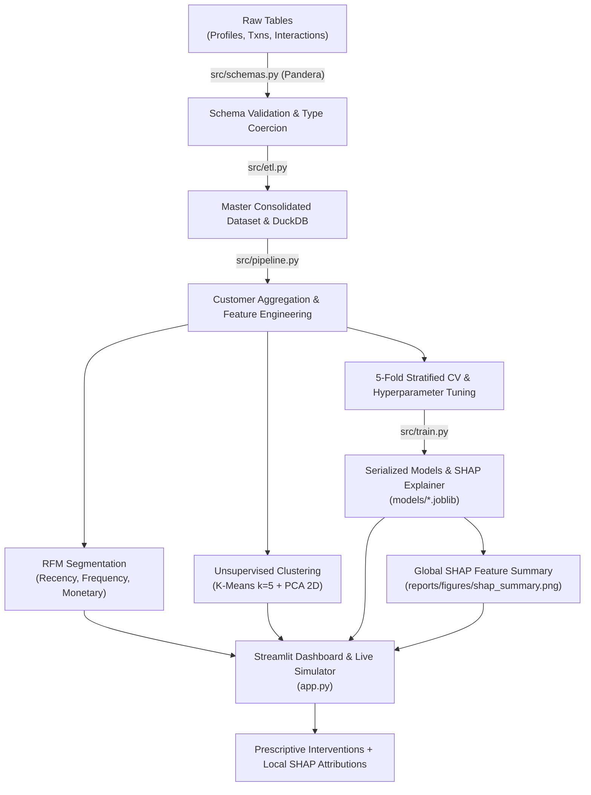

# 💳 Fintech Customer Analytics & Explainable Churn Prediction

A comprehensive end-to-end data science and machine learning platform for analyzing digital banking customer behavior, transaction patterns, customer satisfaction (NPS), RFM segmentation, and proactive churn risk prediction with **Pandera data validation contracts, Stratified 5-Fold Cross-Validation, SHAP model explainability, Docker containerization, and GitHub Actions CI/CD**.

---

## 🚀 Project Overview

In fintech and digital banking, customer retention is directly tied to customer lifetime value (LTV). Identifying disengagement before churn occurs enables proactive retention interventions.

This platform provides:
- **Data Contracts & Integrity**: Strict Pandera schemas validating incoming raw tables and feature stores.
- **Centralized Structured Logging**: Rotating console and persistent file logs (`logs/fintech_platform.log`).
- **Customer Segmentation**: Unsupervised K-Means clustering and RFM (Recency, Frequency, Monetary) behavioral scoring.
- **Sentiment & Experience Analytics**: Net Promoter Score (NPS) analysis coupled with customer service ticket volumes and channel preferences.
- **Predictive Churn Modeling**: 5-Fold Stratified Cross-Validation with hyperparameter tuning on Random Forest, Gradient Boosting, and Logistic Regression.
- **Explainable AI (XAI)**: SHAP TreeExplainer delivering global summary beeswarm plots and local customer-level waterfall attributions in the live simulator.
- **Real-Time Churn Simulator**: Interactive what-if evaluation for single customer profiles with prescriptive retention recommendations.
- **Production DevOps**: Multi-stage Docker containerization, `docker-compose`, `pyproject.toml`, and GitHub Actions CI/CD.

---

## 🔬 Analytical & Machine Learning Workflow

### 1. Data Extraction & Pandera Validation ETL
- Raw tables undergo schema validation via `src/schemas.py` using **Pandera**, ensuring strictly bounded age, non-negative transaction amounts, valid categorical sets, and valid NPS ratings.
- Aggregated transactions and interactions are persisted in `data/processed/master_dataset.csv` and embedded DuckDB `data/database/master_dataset.db`.

### 2. Feature Engineering & Preprocessing
- **Dynamic Recency & Tenure**: Measured against the maximum interaction timestamp with non-negative bounds.
- **Activity Velocities**: `txn_frequency` (annualized transactions), `interaction_frequency`, and `ticket_rate`.
- **Target Definitions**:
  - `churn_risk`: Active (`recency <= 60d`), At Risk (`60d < recency <= 120d`), Churned (`recency > 120d`).
  - `is_churned`: Binary flag (`churn_risk == 'Churned'`).

### 3. RFM Customer Segmentation
- Quantile quintiles ($Q_1$ to $Q_5$) computed for Tenure/Recency, Transaction Frequency, and Monetary Volume.
- Mapped to business cohorts: *Champions*, *Loyal Customers*, *New Customers*, *Big Spenders*, *At Risk*, *Lost Customers*, and *Regular Customers*.

### 4. K-Means Clustering & PCA
- Features normalized via `StandardScaler`.
- Elbow method evaluated over $k \in [2, 10]$ confirming optimal $k=5$.
- 2-component PCA projected into 2D space for visual boundary evaluation.

### 5. Supervised Churn Prediction & Imbalance Metrics
- Evaluated on a stratified 70/30 train/test split:
  - **Random Forest Classifier**: Tuned with 5-Fold `StratifiedKFold` Cross-Validation optimizing for Precision-Recall AUC (PR-AUC).
  - **Gradient Boosting Classifier**: Non-linear ensemble ($n=200$, depth=5).
  - **Logistic Regression**: L2 regularized, balanced class weights.
- **Comprehensive Evaluation**:
  - **ROC-AUC**: Evaluates overall classification ranking.
  - **PR-AUC (Average Precision)**: Evaluates performance directly on the minority churned class.
  - **F1-Score**: Harmonic mean of precision and recall.

### 6. SHAP Explainability Engine (Global & Local)
- **Global Attribution**: TreeExplainer computes SHAP interaction effects across the hold-out test set, visualizing how digital login dormancy, low NPS, and service tickets drive churn.
- **Local Attribution**: Every prediction in the interactive simulator generates directional SHAP impact values explaining *why* the profile scored at its specific risk level.

### 7. Strategic Retention Priority Matrix
- Combines predicted **Churn Probability** with **Customer Value** tiers:
  - **Critical Risk - Immediate Action**: High-value accounts with churn probability $\ge 0.70$.
  - **High Risk - Proactive Outreach**: Accounts with churn probability $\ge 0.50$.
  - **Medium Risk - Monitor Closely**: Churn probability $\ge 0.30$.
  - **Low Risk - Maintain Engagement**: Healthy accounts.

---
